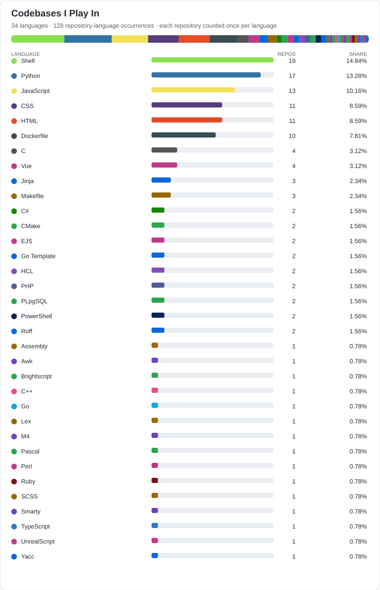

# dahknesh232

<!-- START -->
## Repository Activity

**Repositories analyzed:** 65 (7 public, 58 private) · **Distinct repository commits:** 3,766

> 🔒 denotes a private repository. Names and links are public, but GitHub restricts repository access to authorized users. Use the Request access link to submit a public GitHub Issue; submitting does not grant repository access.

### Recently Touched 🕒

| Repository | Latest push (UTC) |
|---|---|
| [dahknesh232](https://github.com/dahknesh232/dahknesh232) | 2026-10-21 |
| [auto 🔒](https://github.com/dahknesh232/auto) ([Request access](https://github.com/dahknesh232/dahknesh232/issues/new?template=private-repository-access.yml&title=%5BAccess%20Request%5D%20dahknesh232%2Fauto)) | 2026-10-18 |
| [readme-profile 🔒](https://github.com/dahknesh232/readme-profile) ([Request access](https://github.com/dahknesh232/dahknesh232/issues/new?template=private-repository-access.yml&title=%5BAccess%20Request%5D%20dahknesh232%2Freadme-profile)) | 2026-10-14 |
| [homelab2 🔒](https://github.com/dahknesh232/homelab2) ([Request access](https://github.com/dahknesh232/dahknesh232/issues/new?template=private-repository-access.yml&title=%5BAccess%20Request%5D%20dahknesh232%2Fhomelab2)) | 2026-10-12 |
| [tfans 🔒](https://github.com/dahknesh232/tfans) ([Request access](https://github.com/dahknesh232/dahknesh232/issues/new?template=private-repository-access.yml&title=%5BAccess%20Request%5D%20dahknesh232%2Ftfans)) | 2026-10-12 |
| [ivr 🔒](https://github.com/dahknesh232/ivr) ([Request access](https://github.com/dahknesh232/dahknesh232/issues/new?template=private-repository-access.yml&title=%5BAccess%20Request%5D%20dahknesh232%2Fivr)) | 2026-10-10 |
| [vue 🔒](https://github.com/dahknesh232/vue) ([Request access](https://github.com/dahknesh232/dahknesh232/issues/new?template=private-repository-access.yml&title=%5BAccess%20Request%5D%20dahknesh232%2Fvue)) | 2026-10-10 |
| [StoryBoard 🔒](https://github.com/dahknesh232/StoryBoard) ([Request access](https://github.com/dahknesh232/dahknesh232/issues/new?template=private-repository-access.yml&title=%5BAccess%20Request%5D%20dahknesh232%2FStoryBoard)) | 2026-10-10 |
| [dev 🔒](https://github.com/dahknesh232/dev) ([Request access](https://github.com/dahknesh232/dahknesh232/issues/new?template=private-repository-access.yml&title=%5BAccess%20Request%5D%20dahknesh232%2Fdev)) | 2026-10-10 |
| [ce-io 🔒](https://github.com/dahknesh232/ce-io) ([Request access](https://github.com/dahknesh232/dahknesh232/issues/new?template=private-repository-access.yml&title=%5BAccess%20Request%5D%20dahknesh232%2Fce-io)) | 2026-10-03 |

### Favorite Repos ⭐

| Repository | Git commits (all branches/tags) |
|---|---:|
| [ivr 🔒](https://github.com/dahknesh232/ivr) ([Request access](https://github.com/dahknesh232/dahknesh232/issues/new?template=private-repository-access.yml&title=%5BAccess%20Request%5D%20dahknesh232%2Fivr)) | 488 |
| [BuildK8s 🔒](https://github.com/dahknesh232/BuildK8s) ([Request access](https://github.com/dahknesh232/dahknesh232/issues/new?template=private-repository-access.yml&title=%5BAccess%20Request%5D%20dahknesh232%2FBuildK8s)) | 451 |
| [mcs 🔒](https://github.com/dahknesh232/mcs) ([Request access](https://github.com/dahknesh232/dahknesh232/issues/new?template=private-repository-access.yml&title=%5BAccess%20Request%5D%20dahknesh232%2Fmcs)) | 379 |
| [OHC 🔒](https://github.com/dahknesh232/OHC) ([Request access](https://github.com/dahknesh232/dahknesh232/issues/new?template=private-repository-access.yml&title=%5BAccess%20Request%5D%20dahknesh232%2FOHC)) | 302 |
| [homelab2 🔒](https://github.com/dahknesh232/homelab2) ([Request access](https://github.com/dahknesh232/dahknesh232/issues/new?template=private-repository-access.yml&title=%5BAccess%20Request%5D%20dahknesh232%2Fhomelab2)) | 261 |
| [cdnwork 🔒](https://github.com/dahknesh232/cdnwork) ([Request access](https://github.com/dahknesh232/dahknesh232/issues/new?template=private-repository-access.yml&title=%5BAccess%20Request%5D%20dahknesh232%2Fcdnwork)) | 217 |
| [testapps](https://github.com/dahknesh232/testapps) | 182 |
| [mcs2 🔒](https://github.com/dahknesh232/mcs2) ([Request access](https://github.com/dahknesh232/dahknesh232/issues/new?template=private-repository-access.yml&title=%5BAccess%20Request%5D%20dahknesh232%2Fmcs2)) | 180 |
| [agentic 🔒](https://github.com/dahknesh232/agentic) ([Request access](https://github.com/dahknesh232/dahknesh232/issues/new?template=private-repository-access.yml&title=%5BAccess%20Request%5D%20dahknesh232%2Fagentic)) | 175 |
| [mbzcli 🔒](https://github.com/dahknesh232/mbzcli) ([Request access](https://github.com/dahknesh232/dahknesh232/issues/new?template=private-repository-access.yml&title=%5BAccess%20Request%5D%20dahknesh232%2Fmbzcli)) | 131 |

### Milestones 🎯

#### Current

| Repository | Item | Date (UTC) |
|---|---|---|
| [ivr 🔒](https://github.com/dahknesh232/ivr) ([Request access](https://github.com/dahknesh232/dahknesh232/issues/new?template=private-repository-access.yml&title=%5BAccess%20Request%5D%20dahknesh232%2Fivr)) | [M3 - Operational Readiness](https://github.com/dahknesh232/ivr/milestone/12) | 2026-10-10 |
| [agentic 🔒](https://github.com/dahknesh232/agentic) ([Request access](https://github.com/dahknesh232/dahknesh232/issues/new?template=private-repository-access.yml&title=%5BAccess%20Request%5D%20dahknesh232%2Fagentic)) | [v0.9.x — Project Supervisor](https://github.com/dahknesh232/agentic/milestone/4) | 2026-09-27 |
| [agentic 🔒](https://github.com/dahknesh232/agentic) ([Request access](https://github.com/dahknesh232/dahknesh232/issues/new?template=private-repository-access.yml&title=%5BAccess%20Request%5D%20dahknesh232%2Fagentic)) | [v0.8.x — Persistent Project State](https://github.com/dahknesh232/agentic/milestone/3) | 2026-09-26 |
| [agentic 🔒](https://github.com/dahknesh232/agentic) ([Request access](https://github.com/dahknesh232/dahknesh232/issues/new?template=private-repository-access.yml&title=%5BAccess%20Request%5D%20dahknesh232%2Fagentic)) | [v1.0.0 — Autonomous Workflow](https://github.com/dahknesh232/agentic/milestone/16) | 2026-09-25 |
| [agentic 🔒](https://github.com/dahknesh232/agentic) ([Request access](https://github.com/dahknesh232/dahknesh232/issues/new?template=private-repository-access.yml&title=%5BAccess%20Request%5D%20dahknesh232%2Fagentic)) | [v0.20.x — Quiescence and Git0 Lockdown](https://github.com/dahknesh232/agentic/milestone/15) | 2026-09-25 |
| [agentic 🔒](https://github.com/dahknesh232/agentic) ([Request access](https://github.com/dahknesh232/dahknesh232/issues/new?template=private-repository-access.yml&title=%5BAccess%20Request%5D%20dahknesh232%2Fagentic)) | [v0.19.x — Human Status and Observability](https://github.com/dahknesh232/agentic/milestone/14) | 2026-09-25 |
| [agentic 🔒](https://github.com/dahknesh232/agentic) ([Request access](https://github.com/dahknesh232/dahknesh232/issues/new?template=private-repository-access.yml&title=%5BAccess%20Request%5D%20dahknesh232%2Fagentic)) | [v0.18.x — Convergence and Final Audit](https://github.com/dahknesh232/agentic/milestone/13) | 2026-09-25 |
| [agentic 🔒](https://github.com/dahknesh232/agentic) ([Request access](https://github.com/dahknesh232/dahknesh232/issues/new?template=private-repository-access.yml&title=%5BAccess%20Request%5D%20dahknesh232%2Fagentic)) | [v0.17.x — Independent Reassessment](https://github.com/dahknesh232/agentic/milestone/12) | 2026-09-25 |
| [agentic 🔒](https://github.com/dahknesh232/agentic) ([Request access](https://github.com/dahknesh232/dahknesh232/issues/new?template=private-repository-access.yml&title=%5BAccess%20Request%5D%20dahknesh232%2Fagentic)) | [v0.16.x — Loop and Stagnation Detection](https://github.com/dahknesh232/agentic/milestone/11) | 2026-09-25 |
| [agentic 🔒](https://github.com/dahknesh232/agentic) ([Request access](https://github.com/dahknesh232/dahknesh232/issues/new?template=private-repository-access.yml&title=%5BAccess%20Request%5D%20dahknesh232%2Fagentic)) | [v0.15.x — Failure Recovery and Leases](https://github.com/dahknesh232/agentic/milestone/10) | 2026-09-25 |

#### Recently Closed

| Repository | Item | Date (UTC) |
|---|---|---|
| [agentic 🔒](https://github.com/dahknesh232/agentic) ([Request access](https://github.com/dahknesh232/dahknesh232/issues/new?template=private-repository-access.yml&title=%5BAccess%20Request%5D%20dahknesh232%2Fagentic)) | [v0.7.x — Worker Review Correctness](https://github.com/dahknesh232/agentic/milestone/2) | 2026-09-25 |

### LLM & Agentic AI Engineering 🤖

| Domain | Matching repositories |
|---|---|
| LLM Infrastructure | — |
| Agentic AI | [agentic 🔒](https://github.com/dahknesh232/agentic) ([Request access](https://github.com/dahknesh232/dahknesh232/issues/new?template=private-repository-access.yml&title=%5BAccess%20Request%5D%20dahknesh232%2Fagentic)) |
| LLM Orchestration | — |
| AI Controllers & Workers | [agentic 🔒](https://github.com/dahknesh232/agentic) ([Request access](https://github.com/dahknesh232/dahknesh232/issues/new?template=private-repository-access.yml&title=%5BAccess%20Request%5D%20dahknesh232%2Fagentic)) |
| RAG & Knowledge Systems | [OHC-OIDCPyCli 🔒](https://github.com/dahknesh232/OHC-OIDCPyCli) ([Request access](https://github.com/dahknesh232/dahknesh232/issues/new?template=private-repository-access.yml&title=%5BAccess%20Request%5D%20dahknesh232%2FOHC-OIDCPyCli)) |
| Prompt Engineering & Evaluation | — |
| Model Integration | [ivr 🔒](https://github.com/dahknesh232/ivr) ([Request access](https://github.com/dahknesh232/dahknesh232/issues/new?template=private-repository-access.yml&title=%5BAccess%20Request%5D%20dahknesh232%2Fivr)) |
| AI Security | — |

_AI domains are inferred from metadata and tracked paths; matching is heuristic._

### IVR & Conversational Voice Engineering 📞

| Domain | Matching repositories |
|---|---|
| IVR Platforms & Call Flow Engineering | [ivr 🔒](https://github.com/dahknesh232/ivr) ([Request access](https://github.com/dahknesh232/dahknesh232/issues/new?template=private-repository-access.yml&title=%5BAccess%20Request%5D%20dahknesh232%2Fivr)), [readme-profile 🔒](https://github.com/dahknesh232/readme-profile) ([Request access](https://github.com/dahknesh232/dahknesh232/issues/new?template=private-repository-access.yml&title=%5BAccess%20Request%5D%20dahknesh232%2Freadme-profile)) |
| Telephony & SIP Infrastructure | [ivr 🔒](https://github.com/dahknesh232/ivr) ([Request access](https://github.com/dahknesh232/dahknesh232/issues/new?template=private-repository-access.yml&title=%5BAccess%20Request%5D%20dahknesh232%2Fivr)), [makingpythonfun 🔒](https://github.com/dahknesh232/makingpythonfun) ([Request access](https://github.com/dahknesh232/dahknesh232/issues/new?template=private-repository-access.yml&title=%5BAccess%20Request%5D%20dahknesh232%2Fmakingpythonfun)) |
| Contact Center Integrations | — |
| Speech Recognition & Synthesis | [ivr 🔒](https://github.com/dahknesh232/ivr) ([Request access](https://github.com/dahknesh232/dahknesh232/issues/new?template=private-repository-access.yml&title=%5BAccess%20Request%5D%20dahknesh232%2Fivr)), [wrt-adtran 🔒](https://github.com/dahknesh232/wrt-adtran) ([Request access](https://github.com/dahknesh232/dahknesh232/issues/new?template=private-repository-access.yml&title=%5BAccess%20Request%5D%20dahknesh232%2Fwrt-adtran)) |
| Conversational AI & Voice Agents | — |
| DTMF & Call Routing | — |
| IVR APIs & Backend Integration | — |
| Call Analytics, QA & Compliance | — |

_IVR domains are inferred from repository metadata and tracked paths; matching is heuristic._

### Issues 📋

#### Current

| Repository | Item | Date (UTC) |
|---|---|---|
| [ivr 🔒](https://github.com/dahknesh232/ivr) ([Request access](https://github.com/dahknesh232/dahknesh232/issues/new?template=private-repository-access.yml&title=%5BAccess%20Request%5D%20dahknesh232%2Fivr)) | [\[EPIC\] Portal web phase 4 hardening and admin surface completion](https://github.com/dahknesh232/ivr/issues/88) | 2026-10-10 |
| [storyboard-testing 🔒](https://github.com/dahknesh232/storyboard-testing) ([Request access](https://github.com/dahknesh232/dahknesh232/issues/new?template=private-repository-access.yml&title=%5BAccess%20Request%5D%20dahknesh232%2Fstoryboard-testing)) | [\[Storyboard\] Design](https://github.com/dahknesh232/storyboard-testing/issues/4) | 2026-05-27 |
| [ivr 🔒](https://github.com/dahknesh232/ivr) ([Request access](https://github.com/dahknesh232/dahknesh232/issues/new?template=private-repository-access.yml&title=%5BAccess%20Request%5D%20dahknesh232%2Fivr)) | [\[TASK\] Convert portal-web route modules to lazy-loaded dynamic imports](https://github.com/dahknesh232/ivr/issues/90) | 2026-04-02 |
| [ivr 🔒](https://github.com/dahknesh232/ivr) ([Request access](https://github.com/dahknesh232/dahknesh232/issues/new?template=private-repository-access.yml&title=%5BAccess%20Request%5D%20dahknesh232%2Fivr)) | [\[TASK\] Add reusable skeleton loading primitives for portal-web surfaces](https://github.com/dahknesh232/ivr/issues/91) | 2026-04-02 |
| [ivr 🔒](https://github.com/dahknesh232/ivr) ([Request access](https://github.com/dahknesh232/dahknesh232/issues/new?template=private-repository-access.yml&title=%5BAccess%20Request%5D%20dahknesh232%2Fivr)) | [\[FEATURE\] Add dedicated admin route namespace and role-gated admin layout](https://github.com/dahknesh232/ivr/issues/92) | 2026-04-02 |
| [ivr 🔒](https://github.com/dahknesh232/ivr) ([Request access](https://github.com/dahknesh232/dahknesh232/issues/new?template=private-repository-access.yml&title=%5BAccess%20Request%5D%20dahknesh232%2Fivr)) | [\[FEATURE\] Add portal-web settings and user preferences surface](https://github.com/dahknesh232/ivr/issues/93) | 2026-04-02 |
| [ivr 🔒](https://github.com/dahknesh232/ivr) ([Request access](https://github.com/dahknesh232/dahknesh232/issues/new?template=private-repository-access.yml&title=%5BAccess%20Request%5D%20dahknesh232%2Fivr)) | [\[FEATURE\] Add portal-web module registry management workflows](https://github.com/dahknesh232/ivr/issues/94) | 2026-04-02 |
| [ivr 🔒](https://github.com/dahknesh232/ivr) ([Request access](https://github.com/dahknesh232/dahknesh232/issues/new?template=private-repository-access.yml&title=%5BAccess%20Request%5D%20dahknesh232%2Fivr)) | [\[TASK\] Define shared optimistic mutation and rollback pattern for portal-web](https://github.com/dahknesh232/ivr/issues/95) | 2026-04-02 |
| [ivr 🔒](https://github.com/dahknesh232/ivr) ([Request access](https://github.com/dahknesh232/dahknesh232/issues/new?template=private-repository-access.yml&title=%5BAccess%20Request%5D%20dahknesh232%2Fivr)) | [\[INFRA\] Add portal-web accessibility audit workflow and CI checks](https://github.com/dahknesh232/ivr/issues/96) | 2026-04-02 |

#### Recently Closed

| Repository | Item | Date (UTC) |
|---|---|---|
| [ivr 🔒](https://github.com/dahknesh232/ivr) ([Request access](https://github.com/dahknesh232/dahknesh232/issues/new?template=private-repository-access.yml&title=%5BAccess%20Request%5D%20dahknesh232%2Fivr)) | [\[BUG\] 500 Internal Server Error on New Seed Document Revision](https://github.com/dahknesh232/ivr/issues/99) | 2026-10-10 |
| [ivr 🔒](https://github.com/dahknesh232/ivr) ([Request access](https://github.com/dahknesh232/dahknesh232/issues/new?template=private-repository-access.yml&title=%5BAccess%20Request%5D%20dahknesh232%2Fivr)) | [\[INFRA\] Add portal-web automated test harness and CI validation](https://github.com/dahknesh232/ivr/issues/89) | 2026-10-10 |
| [agentic 🔒](https://github.com/dahknesh232/agentic) ([Request access](https://github.com/dahknesh232/dahknesh232/issues/new?template=private-repository-access.yml&title=%5BAccess%20Request%5D%20dahknesh232%2Fagentic)) | [Phase 4.1: define deterministic Supervisor readiness](https://github.com/dahknesh232/agentic/issues/40) | 2026-09-27 |
| [agentic 🔒](https://github.com/dahknesh232/agentic) ([Request access](https://github.com/dahknesh232/dahknesh232/issues/new?template=private-repository-access.yml&title=%5BAccess%20Request%5D%20dahknesh232%2Fagentic)) | [Phase 3.4: Record task provenance](https://github.com/dahknesh232/agentic/issues/38) | 2026-09-26 |
| [agentic 🔒](https://github.com/dahknesh232/agentic) ([Request access](https://github.com/dahknesh232/dahknesh232/issues/new?template=private-repository-access.yml&title=%5BAccess%20Request%5D%20dahknesh232%2Fagentic)) | [Phase 3.3: Add durable task states](https://github.com/dahknesh232/agentic/issues/32) | 2026-09-26 |
| [agentic 🔒](https://github.com/dahknesh232/agentic) ([Request access](https://github.com/dahknesh232/dahknesh232/issues/new?template=private-repository-access.yml&title=%5BAccess%20Request%5D%20dahknesh232%2Fagentic)) | [Phase 3.2: Separate requirements from tasks](https://github.com/dahknesh232/agentic/issues/30) | 2026-09-26 |
| [agentic 🔒](https://github.com/dahknesh232/agentic) ([Request access](https://github.com/dahknesh232/dahknesh232/issues/new?template=private-repository-access.yml&title=%5BAccess%20Request%5D%20dahknesh232%2Fagentic)) | [Phase 3.1: Introduce durable Project state](https://github.com/dahknesh232/agentic/issues/28) | 2026-09-26 |
| [agentic 🔒](https://github.com/dahknesh232/agentic) ([Request access](https://github.com/dahknesh232/dahknesh232/issues/new?template=private-repository-access.yml&title=%5BAccess%20Request%5D%20dahknesh232%2Fagentic)) | [Phase 2.4: declare Worker transaction primitive stable](https://github.com/dahknesh232/agentic/issues/26) | 2026-09-25 |
| [agentic 🔒](https://github.com/dahknesh232/agentic) ([Request access](https://github.com/dahknesh232/dahknesh232/issues/new?template=private-repository-access.yml&title=%5BAccess%20Request%5D%20dahknesh232%2Fagentic)) | [Phase 2.3: validate Worker review decisions](https://github.com/dahknesh232/agentic/issues/24) | 2026-09-25 |
| [agentic 🔒](https://github.com/dahknesh232/agentic) ([Request access](https://github.com/dahknesh232/dahknesh232/issues/new?template=private-repository-access.yml&title=%5BAccess%20Request%5D%20dahknesh232%2Fagentic)) | [Phase 2.2: verify Worker review safeguards](https://github.com/dahknesh232/agentic/issues/22) | 2026-09-25 |

### Pull Requests 🔀

#### Current

| Repository | Item | Date (UTC) |
|---|---|---|
| [StoryBoard 🔒](https://github.com/dahknesh232/StoryBoard) ([Request access](https://github.com/dahknesh232/dahknesh232/issues/new?template=private-repository-access.yml&title=%5BAccess%20Request%5D%20dahknesh232%2FStoryBoard)) | [Bump the pip group across 1 directory with 5 updates](https://github.com/dahknesh232/StoryBoard/pull/9) | 2026-10-10 |
| [ce-io 🔒](https://github.com/dahknesh232/ce-io) ([Request access](https://github.com/dahknesh232/dahknesh232/issues/new?template=private-repository-access.yml&title=%5BAccess%20Request%5D%20dahknesh232%2Fce-io)) | [Remove makefiles](https://github.com/dahknesh232/ce-io/pull/1) | 2026-10-03 |
| [agentic 🔒](https://github.com/dahknesh232/agentic) ([Request access](https://github.com/dahknesh232/dahknesh232/issues/new?template=private-repository-access.yml&title=%5BAccess%20Request%5D%20dahknesh232%2Fagentic)) | [Corrective 0.9.0a-19-8: Preserve Linux and Git evidence contracts](https://github.com/dahknesh232/agentic/pull/42) | 2026-09-30 |

#### Recently Closed

| Repository | Item | Date (UTC) |
|---|---|---|
| [tfans 🔒](https://github.com/dahknesh232/tfans) ([Request access](https://github.com/dahknesh232/dahknesh232/issues/new?template=private-repository-access.yml&title=%5BAccess%20Request%5D%20dahknesh232%2Ftfans)) | [Fix runner bootstrap, Terraform layout, and Vault LXC startup](https://github.com/dahknesh232/tfans/pull/1) | 2026-10-12 |
| [ivr 🔒](https://github.com/dahknesh232/ivr) ([Request access](https://github.com/dahknesh232/dahknesh232/issues/new?template=private-repository-access.yml&title=%5BAccess%20Request%5D%20dahknesh232%2Fivr)) | [feature/88-epic-portal-web-phase-4](https://github.com/dahknesh232/ivr/pull/97) | 2026-10-10 |
| [ivr 🔒](https://github.com/dahknesh232/ivr) ([Request access](https://github.com/dahknesh232/dahknesh232/issues/new?template=private-repository-access.yml&title=%5BAccess%20Request%5D%20dahknesh232%2Fivr)) | [feature/89-add-portal-web-automated-test](https://github.com/dahknesh232/ivr/pull/98) | 2026-10-10 |
| [vue 🔒](https://github.com/dahknesh232/vue) ([Request access](https://github.com/dahknesh232/dahknesh232/issues/new?template=private-repository-access.yml&title=%5BAccess%20Request%5D%20dahknesh232%2Fvue)) | [Bump the npm_and_yarn group across 1 directory with 2 updates](https://github.com/dahknesh232/vue/pull/3) | 2026-10-10 |
| [vue 🔒](https://github.com/dahknesh232/vue) ([Request access](https://github.com/dahknesh232/dahknesh232/issues/new?template=private-repository-access.yml&title=%5BAccess%20Request%5D%20dahknesh232%2Fvue)) | [Bump rollup from 4.16.1 to 4.64.5](https://github.com/dahknesh232/vue/pull/2) | 2026-10-10 |
| [vue 🔒](https://github.com/dahknesh232/vue) ([Request access](https://github.com/dahknesh232/dahknesh232/issues/new?template=private-repository-access.yml&title=%5BAccess%20Request%5D%20dahknesh232%2Fvue)) | [Bump the npm_and_yarn group across 1 directory with 15 updates](https://github.com/dahknesh232/vue/pull/1) | 2026-10-10 |
| [StoryBoard 🔒](https://github.com/dahknesh232/StoryBoard) ([Request access](https://github.com/dahknesh232/dahknesh232/issues/new?template=private-repository-access.yml&title=%5BAccess%20Request%5D%20dahknesh232%2FStoryBoard)) | [Bump the pip group across 1 directory with 4 updates](https://github.com/dahknesh232/StoryBoard/pull/8) | 2026-10-10 |
| [StoryBoard 🔒](https://github.com/dahknesh232/StoryBoard) ([Request access](https://github.com/dahknesh232/dahknesh232/issues/new?template=private-repository-access.yml&title=%5BAccess%20Request%5D%20dahknesh232%2FStoryBoard)) | [Bump starlette from 1.0.0 to 1.0.1 in the pip group across 1 directory](https://github.com/dahknesh232/StoryBoard/pull/7) | 2026-10-10 |
| [dev 🔒](https://github.com/dahknesh232/dev) ([Request access](https://github.com/dahknesh232/dahknesh232/issues/new?template=private-repository-access.yml&title=%5BAccess%20Request%5D%20dahknesh232%2Fdev)) | [Bump the bundler group across 1 directory with 18 updates](https://github.com/dahknesh232/dev/pull/2) | 2026-10-10 |
| [agentic 🔒](https://github.com/dahknesh232/agentic) ([Request access](https://github.com/dahknesh232/dahknesh232/issues/new?template=private-repository-access.yml&title=%5BAccess%20Request%5D%20dahknesh232%2Fagentic)) | [Scope required Git evidence by repository](https://github.com/dahknesh232/agentic/pull/2) | 2026-09-27 |

### InfoSec Domains 🛡️

| Domain | Matching repositories |
|---|---|
| Network Security | [mcs2 🔒](https://github.com/dahknesh232/mcs2) ([Request access](https://github.com/dahknesh232/dahknesh232/issues/new?template=private-repository-access.yml&title=%5BAccess%20Request%5D%20dahknesh232%2Fmcs2)), [wrt-adtran 🔒](https://github.com/dahknesh232/wrt-adtran) ([Request access](https://github.com/dahknesh232/dahknesh232/issues/new?template=private-repository-access.yml&title=%5BAccess%20Request%5D%20dahknesh232%2Fwrt-adtran)) |
| Application Security | [BuildK8s 🔒](https://github.com/dahknesh232/BuildK8s) ([Request access](https://github.com/dahknesh232/dahknesh232/issues/new?template=private-repository-access.yml&title=%5BAccess%20Request%5D%20dahknesh232%2FBuildK8s)), [OHC 🔒](https://github.com/dahknesh232/OHC) ([Request access](https://github.com/dahknesh232/dahknesh232/issues/new?template=private-repository-access.yml&title=%5BAccess%20Request%5D%20dahknesh232%2FOHC)), [OHC-OIDCPyCli 🔒](https://github.com/dahknesh232/OHC-OIDCPyCli) ([Request access](https://github.com/dahknesh232/dahknesh232/issues/new?template=private-repository-access.yml&title=%5BAccess%20Request%5D%20dahknesh232%2FOHC-OIDCPyCli)), [OHCPGDB 🔒](https://github.com/dahknesh232/OHCPGDB) ([Request access](https://github.com/dahknesh232/dahknesh232/issues/new?template=private-repository-access.yml&title=%5BAccess%20Request%5D%20dahknesh232%2FOHCPGDB)), [cdnwork 🔒](https://github.com/dahknesh232/cdnwork) ([Request access](https://github.com/dahknesh232/dahknesh232/issues/new?template=private-repository-access.yml&title=%5BAccess%20Request%5D%20dahknesh232%2Fcdnwork)), [ivr 🔒](https://github.com/dahknesh232/ivr) ([Request access](https://github.com/dahknesh232/dahknesh232/issues/new?template=private-repository-access.yml&title=%5BAccess%20Request%5D%20dahknesh232%2Fivr)), [testapps](https://github.com/dahknesh232/testapps), [wrt-adtran 🔒](https://github.com/dahknesh232/wrt-adtran) ([Request access](https://github.com/dahknesh232/dahknesh232/issues/new?template=private-repository-access.yml&title=%5BAccess%20Request%5D%20dahknesh232%2Fwrt-adtran)) |
| Identity & Access Management | [OHC-OIDCPyCli 🔒](https://github.com/dahknesh232/OHC-OIDCPyCli) ([Request access](https://github.com/dahknesh232/dahknesh232/issues/new?template=private-repository-access.yml&title=%5BAccess%20Request%5D%20dahknesh232%2FOHC-OIDCPyCli)), [homelab2 🔒](https://github.com/dahknesh232/homelab2) ([Request access](https://github.com/dahknesh232/dahknesh232/issues/new?template=private-repository-access.yml&title=%5BAccess%20Request%5D%20dahknesh232%2Fhomelab2)), [ivr 🔒](https://github.com/dahknesh232/ivr) ([Request access](https://github.com/dahknesh232/dahknesh232/issues/new?template=private-repository-access.yml&title=%5BAccess%20Request%5D%20dahknesh232%2Fivr)), [testapps](https://github.com/dahknesh232/testapps) |
| Cloud & Container Security | [BuildK8s 🔒](https://github.com/dahknesh232/BuildK8s) ([Request access](https://github.com/dahknesh232/dahknesh232/issues/new?template=private-repository-access.yml&title=%5BAccess%20Request%5D%20dahknesh232%2FBuildK8s)), [OHC 🔒](https://github.com/dahknesh232/OHC) ([Request access](https://github.com/dahknesh232/dahknesh232/issues/new?template=private-repository-access.yml&title=%5BAccess%20Request%5D%20dahknesh232%2FOHC)), [ansible-testing](https://github.com/dahknesh232/ansible-testing), [cdnwork 🔒](https://github.com/dahknesh232/cdnwork) ([Request access](https://github.com/dahknesh232/dahknesh232/issues/new?template=private-repository-access.yml&title=%5BAccess%20Request%5D%20dahknesh232%2Fcdnwork)), [homelab 🔒](https://github.com/dahknesh232/homelab) ([Request access](https://github.com/dahknesh232/dahknesh232/issues/new?template=private-repository-access.yml&title=%5BAccess%20Request%5D%20dahknesh232%2Fhomelab)), [homelab2 🔒](https://github.com/dahknesh232/homelab2) ([Request access](https://github.com/dahknesh232/dahknesh232/issues/new?template=private-repository-access.yml&title=%5BAccess%20Request%5D%20dahknesh232%2Fhomelab2)), [ivr 🔒](https://github.com/dahknesh232/ivr) ([Request access](https://github.com/dahknesh232/dahknesh232/issues/new?template=private-repository-access.yml&title=%5BAccess%20Request%5D%20dahknesh232%2Fivr)), [mcs 🔒](https://github.com/dahknesh232/mcs) ([Request access](https://github.com/dahknesh232/dahknesh232/issues/new?template=private-repository-access.yml&title=%5BAccess%20Request%5D%20dahknesh232%2Fmcs)), [mcs2 🔒](https://github.com/dahknesh232/mcs2) ([Request access](https://github.com/dahknesh232/dahknesh232/issues/new?template=private-repository-access.yml&title=%5BAccess%20Request%5D%20dahknesh232%2Fmcs2)), [testapps](https://github.com/dahknesh232/testapps), [tfans 🔒](https://github.com/dahknesh232/tfans) ([Request access](https://github.com/dahknesh232/dahknesh232/issues/new?template=private-repository-access.yml&title=%5BAccess%20Request%5D%20dahknesh232%2Ftfans)) |
| Offensive Security | [wrt-adtran 🔒](https://github.com/dahknesh232/wrt-adtran) ([Request access](https://github.com/dahknesh232/dahknesh232/issues/new?template=private-repository-access.yml&title=%5BAccess%20Request%5D%20dahknesh232%2Fwrt-adtran)) |
| Defensive Security & Detection | [wrt-adtran 🔒](https://github.com/dahknesh232/wrt-adtran) ([Request access](https://github.com/dahknesh232/dahknesh232/issues/new?template=private-repository-access.yml&title=%5BAccess%20Request%5D%20dahknesh232%2Fwrt-adtran)) |
| Cryptography & Secrets | [OHC-OIDCPyCli 🔒](https://github.com/dahknesh232/OHC-OIDCPyCli) ([Request access](https://github.com/dahknesh232/dahknesh232/issues/new?template=private-repository-access.yml&title=%5BAccess%20Request%5D%20dahknesh232%2FOHC-OIDCPyCli)), [bs216 🔒](https://github.com/dahknesh232/bs216) ([Request access](https://github.com/dahknesh232/dahknesh232/issues/new?template=private-repository-access.yml&title=%5BAccess%20Request%5D%20dahknesh232%2Fbs216)), [testapps](https://github.com/dahknesh232/testapps), [tfans 🔒](https://github.com/dahknesh232/tfans) ([Request access](https://github.com/dahknesh232/dahknesh232/issues/new?template=private-repository-access.yml&title=%5BAccess%20Request%5D%20dahknesh232%2Ftfans)), [wrt-adtran 🔒](https://github.com/dahknesh232/wrt-adtran) ([Request access](https://github.com/dahknesh232/dahknesh232/issues/new?template=private-repository-access.yml&title=%5BAccess%20Request%5D%20dahknesh232%2Fwrt-adtran)) |
| Forensics & Malware Analysis | [lists 🔒](https://github.com/dahknesh232/lists) ([Request access](https://github.com/dahknesh232/dahknesh232/issues/new?template=private-repository-access.yml&title=%5BAccess%20Request%5D%20dahknesh232%2Flists)) |

_Domains use configurable keyword signals in repository metadata and tracked paths; they are heuristic, not a security assessment._

### GitHub Statistics 📊

| Metric | Value |
|---|---:|
| 🍴 Forks received | 2 |
| 📝 All-time repository commits | 3,766 |
| 🔀 Lines of code changed | 14,271,906 |

### Codebases I Play In 💻

_Language shares count one occurrence per repository containing each language; not weighted by bytes. Forks received are summed from the included repositories. Commit totals and lines changed are repository-history metrics, not personal GitHub contribution-graph totals. Lines changed counts textual additions plus deletions (excluding binary files)._

### Other PlayGrounds 🧪
_Repositories that match no InfoSec, LLM/AI, or IVR/voice engineering domain._

| Repository | Git commits | Last push (UTC) |
|---|---:|---|
| [mbzcli 🔒](https://github.com/dahknesh232/mbzcli) ([Request access](https://github.com/dahknesh232/dahknesh232/issues/new?template=private-repository-access.yml&title=%5BAccess%20Request%5D%20dahknesh232%2Fmbzcli)) | 131 | 2024-11-04 |
| [madeachannel 🔒](https://github.com/dahknesh232/madeachannel) ([Request access](https://github.com/dahknesh232/dahknesh232/issues/new?template=private-repository-access.yml&title=%5BAccess%20Request%5D%20dahknesh232%2Fmadeachannel)) | 90 | 2026-01-29 |
| [mcs-velocity 🔒](https://github.com/dahknesh232/mcs-velocity) ([Request access](https://github.com/dahknesh232/dahknesh232/issues/new?template=private-repository-access.yml&title=%5BAccess%20Request%5D%20dahknesh232%2Fmcs-velocity)) | 79 | 2025-04-13 |
| [mbzbot 🔒](https://github.com/dahknesh232/mbzbot) ([Request access](https://github.com/dahknesh232/dahknesh232/issues/new?template=private-repository-access.yml&title=%5BAccess%20Request%5D%20dahknesh232%2Fmbzbot)) | 65 | 2024-11-05 |
| [gemgem-py 🔒](https://github.com/dahknesh232/gemgem-py) ([Request access](https://github.com/dahknesh232/dahknesh232/issues/new?template=private-repository-access.yml&title=%5BAccess%20Request%5D%20dahknesh232%2Fgemgem-py)) | 50 | 2026-09-23 |
| [ML-Game 🔒](https://github.com/dahknesh232/ML-Game) ([Request access](https://github.com/dahknesh232/dahknesh232/issues/new?template=private-repository-access.yml&title=%5BAccess%20Request%5D%20dahknesh232%2FML-Game)) | 44 | 2024-06-09 |
| [ds-ai 🔒](https://github.com/dahknesh232/ds-ai) ([Request access](https://github.com/dahknesh232/dahknesh232/issues/new?template=private-repository-access.yml&title=%5BAccess%20Request%5D%20dahknesh232%2Fds-ai)) | 40 | 2026-01-29 |
| [LOGOS-Actual 🔒](https://github.com/dahknesh232/LOGOS-Actual) ([Request access](https://github.com/dahknesh232/dahknesh232/issues/new?template=private-repository-access.yml&title=%5BAccess%20Request%5D%20dahknesh232%2FLOGOS-Actual)) | 36 | 2026-01-29 |
| [OHC-Maria 🔒](https://github.com/dahknesh232/OHC-Maria) ([Request access](https://github.com/dahknesh232/dahknesh232/issues/new?template=private-repository-access.yml&title=%5BAccess%20Request%5D%20dahknesh232%2FOHC-Maria)) | 36 | 2024-06-08 |
| [dahknesh232](https://github.com/dahknesh232/dahknesh232) | 34 | 2026-10-21 |
| [StoryBoard 🔒](https://github.com/dahknesh232/StoryBoard) ([Request access](https://github.com/dahknesh232/dahknesh232/issues/new?template=private-repository-access.yml&title=%5BAccess%20Request%5D%20dahknesh232%2FStoryBoard)) | 29 | 2026-10-10 |
| [python-musical 🔒](https://github.com/dahknesh232/python-musical) ([Request access](https://github.com/dahknesh232/dahknesh232/issues/new?template=private-repository-access.yml&title=%5BAccess%20Request%5D%20dahknesh232%2Fpython-musical)) | 27 | 2024-12-03 |
| [mcs-jobs 🔒](https://github.com/dahknesh232/mcs-jobs) ([Request access](https://github.com/dahknesh232/dahknesh232/issues/new?template=private-repository-access.yml&title=%5BAccess%20Request%5D%20dahknesh232%2Fmcs-jobs)) | 20 | 2025-03-20 |
| [fractal 🔒](https://github.com/dahknesh232/fractal) ([Request access](https://github.com/dahknesh232/dahknesh232/issues/new?template=private-repository-access.yml&title=%5BAccess%20Request%5D%20dahknesh232%2Ffractal)) | 19 | 2026-04-13 |
| [vue 🔒](https://github.com/dahknesh232/vue) ([Request access](https://github.com/dahknesh232/dahknesh232/issues/new?template=private-repository-access.yml&title=%5BAccess%20Request%5D%20dahknesh232%2Fvue)) | 17 | 2026-10-10 |
| [dev 🔒](https://github.com/dahknesh232/dev) ([Request access](https://github.com/dahknesh232/dahknesh232/issues/new?template=private-repository-access.yml&title=%5BAccess%20Request%5D%20dahknesh232%2Fdev)) | 8 | 2026-10-10 |
| [evans 🔒](https://github.com/dahknesh232/evans) ([Request access](https://github.com/dahknesh232/dahknesh232/issues/new?template=private-repository-access.yml&title=%5BAccess%20Request%5D%20dahknesh232%2Fevans)) | 8 | 2026-08-16 |
| [ce-io 🔒](https://github.com/dahknesh232/ce-io) ([Request access](https://github.com/dahknesh232/dahknesh232/issues/new?template=private-repository-access.yml&title=%5BAccess%20Request%5D%20dahknesh232%2Fce-io)) | 7 | 2026-10-03 |
| [androidstuff 🔒](https://github.com/dahknesh232/androidstuff) ([Request access](https://github.com/dahknesh232/dahknesh232/issues/new?template=private-repository-access.yml&title=%5BAccess%20Request%5D%20dahknesh232%2Fandroidstuff)) | 6 | 2023-10-11 |
| [.testingimages 🔒](https://github.com/dahknesh232/.testingimages) ([Request access](https://github.com/dahknesh232/dahknesh232/issues/new?template=private-repository-access.yml&title=%5BAccess%20Request%5D%20dahknesh232%2F.testingimages)) | 5 | 2024-07-04 |
| [certusservicetest 🔒](https://github.com/dahknesh232/certusservicetest) ([Request access](https://github.com/dahknesh232/dahknesh232/issues/new?template=private-repository-access.yml&title=%5BAccess%20Request%5D%20dahknesh232%2Fcertusservicetest)) | 5 | 2021-11-14 |
| [micropicostuff 🔒](https://github.com/dahknesh232/micropicostuff) ([Request access](https://github.com/dahknesh232/dahknesh232/issues/new?template=private-repository-access.yml&title=%5BAccess%20Request%5D%20dahknesh232%2Fmicropicostuff)) | 5 | 2026-02-28 |
| [angular 🔒](https://github.com/dahknesh232/angular) ([Request access](https://github.com/dahknesh232/dahknesh232/issues/new?template=private-repository-access.yml&title=%5BAccess%20Request%5D%20dahknesh232%2Fangular)) | 4 | 2023-10-04 |
| [ehrtime 🔒](https://github.com/dahknesh232/ehrtime) ([Request access](https://github.com/dahknesh232/dahknesh232/issues/new?template=private-repository-access.yml&title=%5BAccess%20Request%5D%20dahknesh232%2Fehrtime)) | 4 | 2026-07-27 |
| [bait-detector 🔒](https://github.com/dahknesh232/bait-detector) ([Request access](https://github.com/dahknesh232/dahknesh232/issues/new?template=private-repository-access.yml&title=%5BAccess%20Request%5D%20dahknesh232%2Fbait-detector)) | 3 | 2026-05-19 |
| [phss 🔒](https://github.com/dahknesh232/phss) ([Request access](https://github.com/dahknesh232/dahknesh232/issues/new?template=private-repository-access.yml&title=%5BAccess%20Request%5D%20dahknesh232%2Fphss)) | 3 | 2022-07-27 |
| [pubscriptz 🔒](https://github.com/dahknesh232/pubscriptz) ([Request access](https://github.com/dahknesh232/dahknesh232/issues/new?template=private-repository-access.yml&title=%5BAccess%20Request%5D%20dahknesh232%2Fpubscriptz)) | 3 | 2023-10-11 |
| [react 🔒](https://github.com/dahknesh232/react) ([Request access](https://github.com/dahknesh232/dahknesh232/issues/new?template=private-repository-access.yml&title=%5BAccess%20Request%5D%20dahknesh232%2Freact)) | 3 | 2023-10-04 |
| [schoolstuff 🔒](https://github.com/dahknesh232/schoolstuff) ([Request access](https://github.com/dahknesh232/dahknesh232/issues/new?template=private-repository-access.yml&title=%5BAccess%20Request%5D%20dahknesh232%2Fschoolstuff)) | 3 | 2023-09-26 |
| [flutter 🔒](https://github.com/dahknesh232/flutter) ([Request access](https://github.com/dahknesh232/dahknesh232/issues/new?template=private-repository-access.yml&title=%5BAccess%20Request%5D%20dahknesh232%2Fflutter)) | 2 | 2023-10-11 |
| [mbz-twitch 🔒](https://github.com/dahknesh232/mbz-twitch) ([Request access](https://github.com/dahknesh232/dahknesh232/issues/new?template=private-repository-access.yml&title=%5BAccess%20Request%5D%20dahknesh232%2Fmbz-twitch)) | 2 | 2026-01-29 |
| [ngitest](https://github.com/dahknesh232/ngitest) | 2 | 2025-09-04 |
| [rancherstuff](https://github.com/dahknesh232/rancherstuff) | 2 | 2025-11-09 |
| [scriptz 🔒](https://github.com/dahknesh232/scriptz) ([Request access](https://github.com/dahknesh232/dahknesh232/issues/new?template=private-repository-access.yml&title=%5BAccess%20Request%5D%20dahknesh232%2Fscriptz)) | 2 | 2023-10-11 |
| [svelte 🔒](https://github.com/dahknesh232/svelte) ([Request access](https://github.com/dahknesh232/dahknesh232/issues/new?template=private-repository-access.yml&title=%5BAccess%20Request%5D%20dahknesh232%2Fsvelte)) | 2 | 2023-10-11 |
| [LOGOS](https://github.com/dahknesh232/LOGOS) | 1 | 2024-04-12 |
| [SOE-Commerce 🔒](https://github.com/dahknesh232/SOE-Commerce) ([Request access](https://github.com/dahknesh232/dahknesh232/issues/new?template=private-repository-access.yml&title=%5BAccess%20Request%5D%20dahknesh232%2FSOE-Commerce)) | 1 | 2021-02-25 |
| [auto 🔒](https://github.com/dahknesh232/auto) ([Request access](https://github.com/dahknesh232/dahknesh232/issues/new?template=private-repository-access.yml&title=%5BAccess%20Request%5D%20dahknesh232%2Fauto)) | 1 | 2026-10-18 |
| [rmqstuff 🔒](https://github.com/dahknesh232/rmqstuff) ([Request access](https://github.com/dahknesh232/dahknesh232/issues/new?template=private-repository-access.yml&title=%5BAccess%20Request%5D%20dahknesh232%2Frmqstuff)) | 1 | 2025-09-26 |
| [slecom 🔒](https://github.com/dahknesh232/slecom) ([Request access](https://github.com/dahknesh232/dahknesh232/issues/new?template=private-repository-access.yml&title=%5BAccess%20Request%5D%20dahknesh232%2Fslecom)) | 1 | 2025-05-31 |
| [storyboard-testing 🔒](https://github.com/dahknesh232/storyboard-testing) ([Request access](https://github.com/dahknesh232/dahknesh232/issues/new?template=private-repository-access.yml&title=%5BAccess%20Request%5D%20dahknesh232%2Fstoryboard-testing)) | 1 | 2026-05-27 |
| [these-helm-charts](https://github.com/dahknesh232/these-helm-charts) | 1 | 2024-12-03 |
| [OHCNEW 🔒](https://github.com/dahknesh232/OHCNEW) ([Request access](https://github.com/dahknesh232/dahknesh232/issues/new?template=private-repository-access.yml&title=%5BAccess%20Request%5D%20dahknesh232%2FOHCNEW)) | 0 | 2024-06-08 |
| [mms 🔒](https://github.com/dahknesh232/mms) ([Request access](https://github.com/dahknesh232/dahknesh232/issues/new?template=private-repository-access.yml&title=%5BAccess%20Request%5D%20dahknesh232%2Fmms)) | 0 | 2024-08-15 |
| [polyplugs 🔒](https://github.com/dahknesh232/polyplugs) ([Request access](https://github.com/dahknesh232/dahknesh232/issues/new?template=private-repository-access.yml&title=%5BAccess%20Request%5D%20dahknesh232%2Fpolyplugs)) | 0 | 2024-06-13 |
| [web-assesments 🔒](https://github.com/dahknesh232/web-assesments) ([Request access](https://github.com/dahknesh232/dahknesh232/issues/new?template=private-repository-access.yml&title=%5BAccess%20Request%5D%20dahknesh232%2Fweb-assesments)) | 0 | 2025-02-28 |

### Forgotten Magic 🕰️

**[bs216 🔒](https://github.com/dahknesh232/bs216) ([Request access](https://github.com/dahknesh232/dahknesh232/issues/new?template=private-repository-access.yml&title=%5BAccess%20Request%5D%20dahknesh232%2Fbs216))** · earliest reachable commit 2020-03-23 (committer timestamp)

_Commit counts include unique commits reachable from repository branches and tags. Duplicate history across separate repositories is counted per repository._

<!-- END -->
